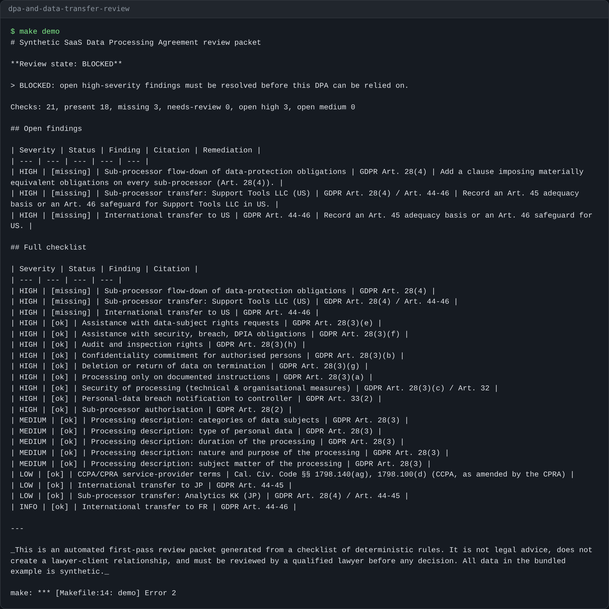

# dpa-and-data-transfer-review

[](https://github.com/sebastianfoerste/dpa-and-data-transfer-review/actions/workflows/ci.yml)

Deterministic, cited GDPR Art. 28 + Chapter V transfer checks; produces a review packet with a visible review state and a gating exit code. Not legal advice; data is synthetic.

**Public-safety posture:** synthetic DPA facts only, cited source provenance, visible review state, a lawyer review gate, and no legal advice.

> **If you don't code:** scroll to [What the demo produces](#what-the-demo-produces). The repository ships a sample output you can read in the browser: a cited checklist with a clear review state. The point is not the code; it is whether the legal review is structured, cited, reviewable, and testable.



*The complete, unedited terminal output of `make demo` on the bundled synthetic DPA, rendered as an image. The last line is make reporting the CLI's gating exit code `2` (`BLOCKED`).*

## Why this exists

Vendor and DPA review is high-volume, repetitive, and easy to do inconsistently. Every miss, a sub-processor in a third country with no transfer mechanism, no flow-down of obligations, or a missing breach-notification clause, is a real exposure. This encodes the recurring GDPR Article 28 and Chapter V checks as deterministic rules with citations, so the routine checks are applied the same way every time and a lawyer's time goes to the judgement calls.

The thesis is the same one that runs through my other repositories: **legal AI and legal automation quality should be measured and reviewable, not asserted.**

## Run it

```bash
git clone https://github.com/sebastianfoerste/dpa-and-data-transfer-review
cd dpa-and-data-transfer-review
make install   # no third-party dependencies, standard library only
make test      # deterministic unit tests
make demo      # prints the packet and writes it, plus the transfer evidence graph, to examples/ (md + json)
```

`make demo` runs end to end, offline and deterministically, against the synthetic DPA in `data/sample_dpa.json`. Because the sample is blocked, the CLI exits `2` and `make` then reports the recipe as failed with `Error 2`: that is make passing on the gating exit code, not a crash. `make test` fails if the committed files in `examples/` or the excerpt below drift from what `make demo` produces.

## What the demo produces

The sample DPA contains three deliberately planted defects. The tool catches all three, marks them `HIGH`, and **blocks** the packet (exit code `2`):

```
# Synthetic SaaS Data Processing Agreement review packet

**Review state: BLOCKED**

> BLOCKED: open high-severity findings must be resolved before this DPA can be relied on.

Checks: 21, present 18, missing 3, needs-review 0, open high 3, open medium 0

## Open findings

| Severity | Status | Finding | Citation | Remediation |
| --- | --- | --- | --- | --- |
| HIGH | [missing] | Sub-processor flow-down of data-protection obligations | GDPR Art. 28(4) | Add a clause imposing materially equivalent obligations on every sub-processor (Art. 28(4)). |
| HIGH | [missing] | Sub-processor transfer: Support Tools LLC (US) | GDPR Art. 28(4) / Art. 44-46 | Record an Art. 45 adequacy basis or an Art. 46 safeguard for Support Tools LLC in US. |
| HIGH | [missing] | International transfer to US | GDPR Art. 44-46 | Record an Art. 45 adequacy basis or an Art. 46 safeguard for US. |
```

The full packet (cleared items included) is committed at [`examples/review-packet.md`](examples/review-packet.md) and [`examples/review-packet.json`](examples/review-packet.json) so you can read a real output without running anything.

The [transfer-chain evidence graph](examples/transfer-evidence-graph.md) maps
controller, processor, sub-processors, and destinations into a reviewable
control graph. Each edge carries the relevant deterministic rule IDs and
citations. The weakest-link view exposes missing flow-down language and
uncovered Chapter V paths while keeping every approval and transfer action
disabled. Its control remediation queue deduplicates each open rule, shows every
affected transfer edge, and routes the required evidence to a named lawyer role.

Fix the three defects in the input (add the flow-down clause, and record SCCs for the direct US transfer and for the US sub-processor), record the transfer impact assessment that SCCs then require, and the packet drops to `NEEDS_REVIEW`: the SCC transfers still go to a lawyer for review. A test asserts exactly this transition.

## AI SaaS legal-team use case

A legal team or reviewer at an AI SaaS company can use this as a privacy review surface before signature:

1. **DPA defects:** the sample packet catches missing sub-processor flow-down and a missing transfer mechanism, both for the direct US transfer and for the US sub-processor. The sample relies on no SCCs or BCR, so the transfer impact assessment check does not fire on it.
2. **Transfer mechanism:** the review distinguishes adequacy (including the EU-US Data Privacy Framework), Art. 46 safeguards, and Art. 49 derogations per destination and sub-processor.
3. **Transfer impact evidence:** where SCCs or BCR are relied on for a transfer outside the EEA, a missing transfer impact assessment is an open `MEDIUM` finding that keeps the packet in review.
4. **Blocked state:** high-severity findings produce `BLOCKED` and exit code `2`, so the review can stop a workflow rather than merely warn.
5. **Lawyer review:** even a remediated packet moves to review, not autonomous approval.

## What it checks

| Area | Citation | What the rule looks for |
| --- | --- | --- |
| Mandatory processor clauses | GDPR Art. 28(3)(a)-(h) | Documented instructions, confidentiality, security, assistance, deletion/return, audit rights |
| Processing description | GDPR Art. 28(3) | Subject matter, duration, nature and purpose, type of personal data, categories of data subjects |
| Sub-processor authorisation | GDPR Art. 28(2) | Specific or general written authorisation |
| Sub-processor flow-down | GDPR Art. 28(4) | Equivalent obligations imposed on sub-processors |
| Breach notification | GDPR Art. 33(2) | Processor-to-controller notice, "without undue delay" |
| International transfers | GDPR Art. 44-46 | EEA vs adequacy (Art. 45) vs SCCs/BCR (Art. 46) vs Art. 49 derogations, per destination **and** per sub-processor |
| EU-US Data Privacy Framework | GDPR Art. 45; Commission Implementing Decision (EU) 2023/1795 | Treated as an adequacy basis, not an Art. 46 safeguard, so no transfer impact assessment is triggered. Requires the US importer to be recorded as actively certified on the Data Privacy Framework List, with a certification that covers the data transferred: non-HR data, and HR data where HR data is transferred. A destination on the tool's adequacy list (for example GB or CH) that is recorded as relying on the DPF or an Art. 49 derogation goes to review, pointing back to its adequacy decision |
| Art. 49 derogations | GDPR Art. 49; EDPB Guidelines 2/2018 on derogations of Article 49 under Regulation 2016/679 (adopted 25 May 2018), section 1 | Derogations apply only where there is no adequacy decision or Art. 46 safeguard, and are interpreted restrictively; a transfer that occurs regularly within a stable relationship can basically be deemed systematic and repeated. Recital 111 expressly limits only the contract and legal-claims derogations (Art. 49(1)(b), (c), (e)) to occasional transfers, and the second subparagraph of Art. 49(1) requires a transfer that is not repetitive; the guidelines read the other derogations as exceptions too. As a conservative default for the ongoing transfers a DPA governs, the tool rates a derogation `HIGH`/missing, like a transfer with no mechanism, unless the transfer is recorded as occasional and not repetitive; then it goes to review |
| Standard Contractual Clauses | GDPR Art. 46(2)(c); Commission Implementing Decision (EU) 2021/914 of 4 June 2021 on standard contractual clauses for the transfer of personal data to third countries | An SCC transfer goes to review: confirm the SCCs, a transfer impact assessment and any supplementary measures |
| Transfer impact assessment | GDPR Art. 46 (CJEU C-311/18); EDPB Recommendations 01/2020 on measures that supplement transfer tools to ensure compliance with the EU level of protection of personal data, version 2.0 (adopted 18 June 2021) | Recorded TIA, with any supplementary measures, where Art. 46 safeguards (SCCs or BCR) are relied on for a destination or sub-processor outside the EEA |
| US service-provider terms | Cal. Civ. Code §§ 1798.140(ag), 1798.100(d) (CCPA, as amended by the CPRA) | Service-provider restrictions where US personal information is in scope |

Recorded yes/no facts are JSON booleans (`true`/`false`); an omitted or `null` fact counts as not recorded, and any other value is refused with exit `3`. `processing.subject_matter`, `processing.duration` and `processing.nature_and_purpose` take a short description or `true`; `false`, an empty string or `null` counts as not stated, and a string that reads as yes or no, such as `"false"`, is refused with exit `3`. `processing.data_types`, `processing.data_subjects` and `transfers.destinations` are lists of non-empty strings. Country codes, in destinations and as keys under `transfers`, are compared without case, and a country recorded twice is refused.

For a `dpf` transfer, the input records the importer's DPF List entry as `dpf_certified` (an active certification), `dpf_covers_non_hr_data` and `dpf_covers_hr_data`: on the sub-processor entry, or keyed by country under `transfers` for direct transfers. `processing.includes_non_hr_data` and `processing.includes_hr_data` record whether each type of data is transferred; if one is omitted and the certification is not recorded as covering that type, the transfer is flagged for review. If both are recorded as `false`, which leaves no data to transfer, a DPF transfer with a recorded certification also goes to review. For a `derogation_art49` transfer, `occasional_and_not_repetitive` (on the sub-processor entry, or keyed by country under `transfers`) records an occasional, non-repetitive transfer.

Reference data (EEA members, adequacy countries, valid mechanisms) is explicit and citeable in [`src/dpa_review/checks.py`](src/dpa_review/checks.py); it is illustrative and should be verified against the current Commission decisions in real use.

## How it is built

- **Deterministic.** Same input, same packet, every time. There is a test for it. No model calls, no network.
- **Cited.** Every finding carries a GDPR/CCPA citation; nothing is asserted without a reference.
- **Reviewable.** Output is a packet with an explicit state and a remediation column, designed to hand to a lawyer, never to replace one.
- **Gating.** `BLOCKED` -> exit `2`, `NEEDS_REVIEW` -> exit `1`, `CLEARED_FOR_REVIEW` -> exit `0`, so it can sit in a pipeline. Exit `3` means the CLI decided no review state: the input could not be read, a field the review reads has the wrong shape (for example a recorded flag that is not `true`/`false`, or categories of data subjects given as one string instead of a list), the command line was wrong, or the review raised an error. A failure before the CLI starts, such as a broken installation, exits `1` as any Python program does, so a pipeline should treat every non-zero exit as not cleared. `make demo` reports any non-zero exit as make's own `Error 2`.

```
src/dpa_review/
  checks.py   # the rules: each maps a feature of the DPA to a citation + severity
  review.py   # engine: runs the rules, decides the review state, renders the packet
  transfer_graph.py # transfer-chain evidence graph and weakest-link analysis
  cli.py      # python -m dpa_review.cli --input data/sample_dpa.json --out examples
data/sample_dpa.json     # synthetic DPA with three planted defects
examples/                # committed sample output (md + json), checked by tests/test_examples.py
tests/                   # deterministic tests, standard-library unittest
```

## Scope and disclaimers

This is a **first-pass triage** tool over a structured representation of a DPA. It does not read free-text contracts, does not give legal advice, and does not establish a lawyer-client relationship. It is designed to make a lawyer faster, not to remove the lawyer. Every bundled example is synthetic; there is no client data, privileged material, or personal data in this repository.

## License

MIT. See [`LICENSE`](LICENSE).

## Human-authored legal judgment
AI tools assisted the implementation, but the parts that carry the value are
human-authored: the GDPR Article 28/Chapter V checks, the adequacy reference data, and
the review-state thresholds. The point of this repository is not code volume; it is showing
how legal judgment can be made structured, testable, and reviewable.

## Business use case
A scaling AI SaaS company receives recurring vendor, customer, and sub-processor
reviews. The questions repeat, but the risk is not zero. This shows how first-pass
privacy review becomes structured, cited, and reviewable while preserving escalation,
source visibility, and human judgment.

## Known limitations
A public-safe prototype, not legal advice.
1. Operates over a structured representation of a DPA, not free-text contracts.
2. The adequacy/transfer reference data is illustrative. Verify against current
   European Commission decisions before any real use.
3. One jurisdiction lens (GDPR + a CCPA secondary check).
4. No integration with a real CLM or ticketing system.
Next production step: free-text ingestion, current adequacy data as a maintained
source, and CLM integration.
